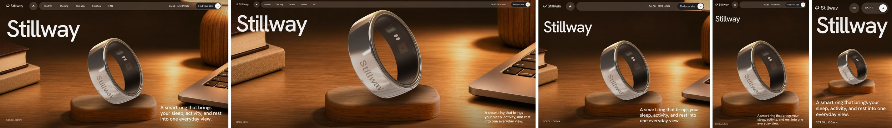

# D-186: S01 plate on the 3840 × 2400 photo (3D Designer 2bcd5bb)

## Integrated
- Plate/overlay sets rebuilt by `scripts/hero-plate.mjs`; the 3632 files are gone. `s01-pedestal-pose.json`
  replaced (GLB unchanged). `heroBg.cam` is read from the JSON; key/fill/spill already were.
- `v1Ratio` 3840/2400, desktop `sizes` `max(114vw, 182.4lvh)`, phone sizes to match.
- `ringLeft` re-measured: 0.3858 (was 0.3957); ring 532 px from the left at 1440 with hover tilt, resting
  552. Wordmark gap 33 px at 1024–1440, 76 px at 1920 (wordmark at its maximum size).
- New above 16:9 only (`heroBg.keepPedestal`): the photo and 3D camera move up so the pedestal's front is
  not cut (about 110 px was lost at 2560 × 1080). 16:9, 16:10 and phones do not move.

## Sizes (AVIF KB / WebP KB; budgets 2560 ≤ 250, 3840 ≤ 450 for AVIF)
Desktop plate 960 29/38, 1280 54/68, 1920 108/138, **2560 171**/214, **3840 338**/374. All files:
`public/hero/plate-s01-sizes.json`. Fetched: 1440@2x `plate-s01-3840` + `ring-s01-3840`; 375@3x
`plate-s01-mp-1816` + `ring-s01-mp-1816`.

## Poster vs live (S01 at rest, sway and highlight forced off, dev server)
| | poster luma p05/25/50/75/95 | live | ring IoU | mean shadow darkening poster / live |
|---|---|---|---|---|
| 1440@2x | 25/44/65/143/193 | 23/45/64/142/188 | 0.977 | 0.204 / 0.159 |
| 375@3x | 25/44/66/141/187 | 23/45/65/142/188 | 0.972 | 0.202 / 0.168 |

Ring bbox equal within 0.5 CSS px. `onion-*.jpg`: poster, live, 50/50 mix, silhouettes (grey both, red
poster only, cyan live only), shadow density (red poster darker, cyan live darker). The silhouette mask is
cut at the live ring's lowest row. `crossfade-strip-*.jpg`: live at 0, 25, 50, 75, 100 %.
`shadow-ratio-1440.jpg`: poster (top) and live (bottom) divided by the bare plate.

## Realism verdict (my visual judgement, not user tested)
Sits naturally at page size: perspective matches the desk, the ring touches the top, both shadows fall
left-front, tone is continuous through the cross-fade. Visible CG tells at 100 %:
1. The live shadow is about 20 % lighter than the poster's, mostly on the pedestal top, so the ring
   loses a little grounding after the cross-fade.
2. The lower band, just above the wood, stays white-silver; it should pick up a warm wood reflection.
   This is the clearest tell.
3. The ring is cleaner and more neutral than the very orange desk.
4. The ring shadow reaching the desk past the pedestal reads as a thin arc around the pedestal's own
   shadow (in both layers, a little clearer live).
5. Plate side (3D Designer's own note): pedestal edges are crisper than the soft foreground desk.

## Checks
- Ring canvas 2880 × 1800 at 1440@2x, 937 × 2030 at 375@3x (DPR kept); near plane, contact occlusion and
  D-185 highlight code unchanged. Clearance 0 to 0.03 mm over the tilt range (no sinking).
- M-11: touch 375, viewport 740 → 812 → 740: photo box and canvas size identical, ring not rescaled.
  Emulation only (headless lvh = load height); no real phone.
- fps (headed Chrome): 60 rest and tilt at 1440 and 375. 1440 with 4× CPU gave 7 to 60 over three runs
  on a loaded machine (load average about 22); the last run was 60 / 59. No real phone GPU.
- No horizontal overflow at the nine viewports tried. At 740 × 360 (landscape phone) the wordmark covers
  the ring and intro; it comes from the unchanged phone rule, not from this plate.

